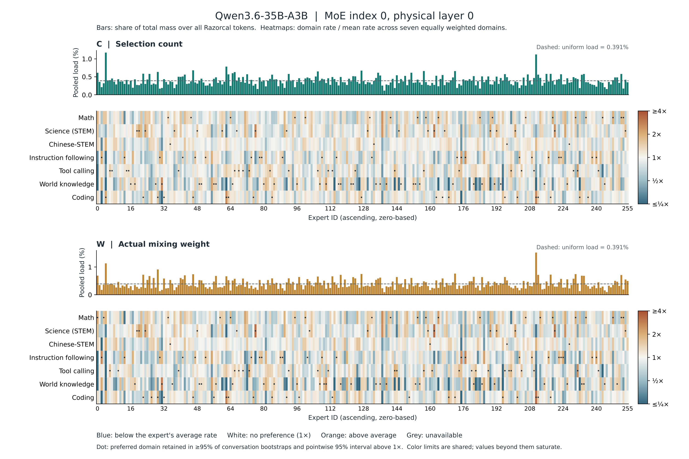
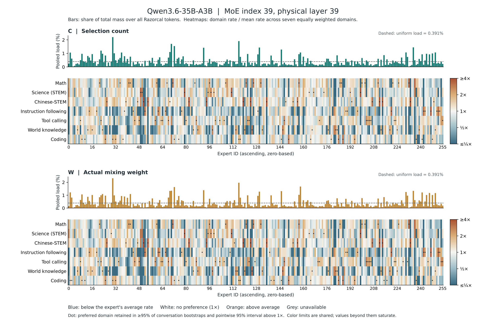
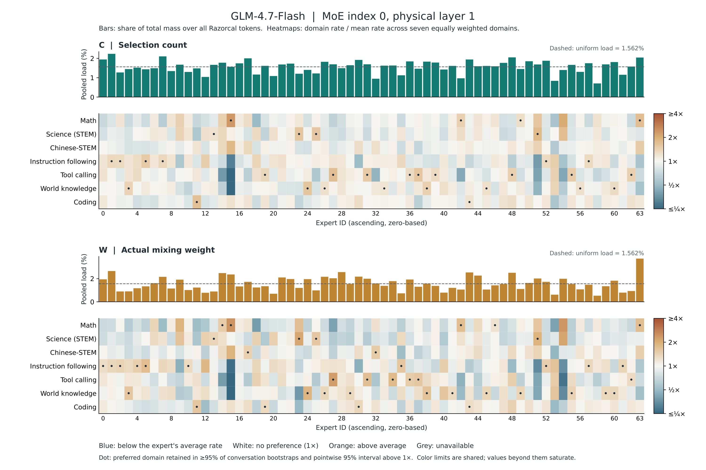
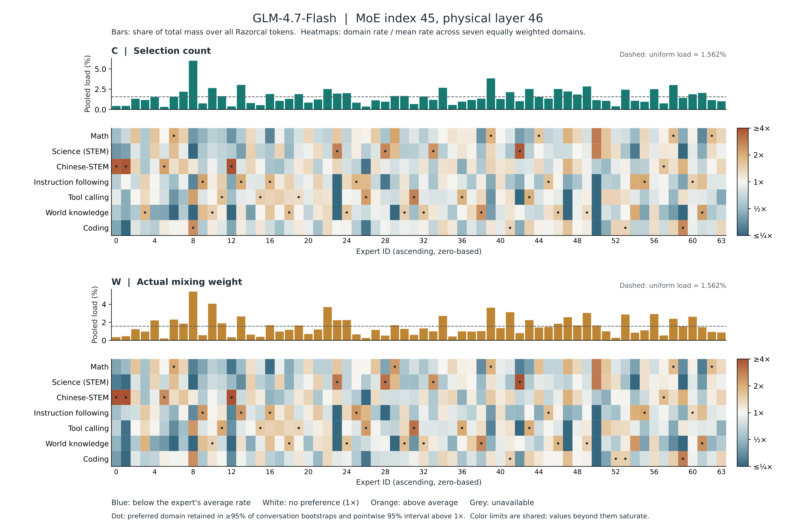

# Expert Domain Usage

Expert load and domain preference on **RAZORCAL**, shown for the first and last MoE layers of **Qwen3.6-35B-A3B** and **GLM-4.7-Flash**.

**How to read the figures.** Each column corresponds to one expert. Bars show its share of total expert load; heatmaps show its per-token usage rate in each domain relative to its mean rate across the seven equally weighted domains. The two panels use selection counts (**C**) and actual mixing weights (**W**). Orange indicates above-average usage, blue below-average usage, and white the 1× baseline. Dots mark preferred domains supported by conversation-level bootstrap resampling.

**Observation.** Experts exhibit overlapping domain usage, with varying degrees of domain preference.

## Qwen3.6-35B-A3B

**First MoE layer — layer 0** · [Vector PDF](figures/qwen36_first_moe_layer.pdf)

**Last MoE layer — layer 39** · [Vector PDF](figures/qwen36_last_moe_layer.pdf)

## GLM-4.7-Flash

**First MoE layer — layer 1** · [Vector PDF](figures/glm47_first_moe_layer.pdf)

**Last MoE layer — layer 46** · [Vector PDF](figures/glm47_last_moe_layer.pdf)

Layer numbers are zero-based physical layer indices. GLM's layer 0 is dense. Expert IDs are local to each layer.
